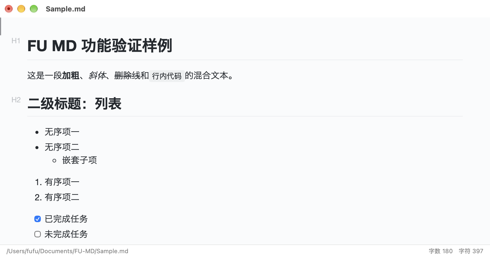
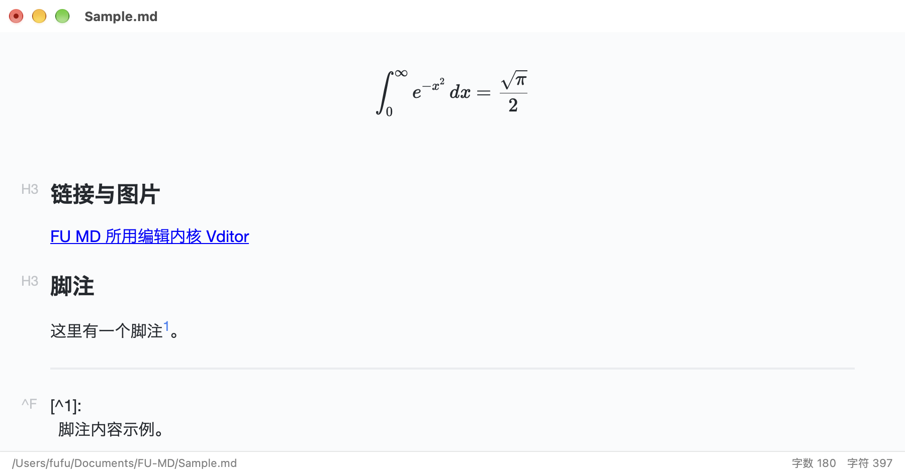

# FU MD

轻量级 Mac Markdown 编辑器：**Typora 式真·所见即所得**即时渲染，没有预览栏、没有编辑/预览模式切换。

## ⬇️ 下载安装

**[→ 点这里下载最新版](https://github.com/fufer97/FU-MD/releases/latest)**

打开页面后在 **Assets** 一栏点 `FU-MD-<版本>.dmg`：

1. 双击 dmg 挂载
2. 把 **FU MD** 拖进「应用程序」
3. 首次打开 **右键 → 打开**（ad-hoc 签名，放行一次即可）

需要 macOS 13 或更高。

---

输入 `# ` 立刻变大标题、`**x**` 立刻变粗体、`- ` 立刻变列表——打字即在排版。应用壳是原生 SwiftUI（窗口、菜单、文件体验都是 Mac 原生的），编辑内核用 [Vditor](https://github.com/Vanessa219/vditor) 的 IR 即时渲染模式，整套资源本地打包，**完全离线可用**。安装包约 13 MB，没有 Electron、没有 `node_modules`。



## 它长什么样

| 界面 | 说明 |
|---|---|
|  | 数学公式走 KaTeX：行内 `$...$` 与独立 `$$...$$` 都按排版结果呈现；链接、脚注同样即时成型 |
| 大标题 / 列表 / 任务列表 | 左侧浅灰角标 `H1`、`H2`、`^F` 标出块类型，正文按排版结果展示；任务列表可直接勾选 |
| 底部状态栏 | 左侧是文件完整路径（未保存时显示「未命名（未保存）」），右侧是字数与字符统计 |

## 功能特性

- **即时渲染编辑**：GFM 全量语法（标题、列表、表格、任务列表、删除线、自动链接、引用、脚注、图片）
- **数学与图表**：KaTeX 公式、Mermaid 流程图 / 时序图 / 甘特图
- **代码高亮**：highlight.js，明暗两套配色随系统切换
- **文件管理**：打开 / 保存 / 另存为（`.md`、`.markdown`）、最近打开、未保存关闭三按钮确认、拖拽与 Dock 图标打开、多窗口
- **大纲侧栏**：`⌘\` 切换，从渲染结果实时收集标题，点击平滑跳转
- **导出**：HTML（单文件自包含）与 PDF（A4、动态测高）
- **主题**：跟随系统明暗，编辑区 / 内容区 / 代码高亮三套联动

### 快捷键

| 快捷键 | 功能 |
|---|---|
| `⌘N` | 新建窗口 |
| `⌘O` | 打开文件（可多选） |
| `⌘S` | 保存 |
| `⇧⌘S` | 另存为 |
| `⌘W` | 关闭窗口（有未保存改动时弹确认） |
| `⌘\` | 显示 / 隐藏大纲侧栏 |

## 设计要点

- **只做编辑这一件事**：不做文件树、多标签、图床、云端同步——保持启动快、内存低、界面克制
- **内核与壳分离**：编辑器内核用成熟开源实现（Vditor 4.0.0，MIT），Swift 侧只负责窗口、菜单、文件与状态，桥接协议集中在 `Sources/FUMD/EditorBridge.swift`
- **保存以编辑器为准**：落盘前先从 WebView 取当前 Markdown 源码，Swift 侧缓存只用于脏标记与标题，不会存下过期内容
- **内核裁剪**：Vditor 发行包约 23 MB，仓库内只保留 IR 即时渲染必需部分（约 11 MB），移除 9 个未调用的渲染引擎
- **完全离线**：内核、字体、样式全部随包分发，运行时不访问网络

## 构建与运行

需要 macOS 13 或更高，以及 Swift 5.9 以上工具链（Command Line Tools 即可，不需要完整 Xcode）。

| 命令 | 作用 |
|---|---|
| `Scripts/build-app.sh` | 编译并打包 `build/FU MD.app` |
| `Scripts/build-app.sh run` | 打包并启动 |
| `Scripts/build-app.sh dmg` | 打包并生成 `build/FU-MD.dmg` 安装包 |
| `Scripts/make-icon.sh` | 由 `Assets/icon_1024.png` 重新生成 `AppIcon.icns` |
| `Scripts/fetch-vditor.sh` | 升级编辑器内核时重新拉取并裁剪（日常构建**不需要**执行） |
| `Scripts/release.sh <版本> ["说明"]` | 改版本号 → 出 dmg → 提交推送 → 发 GitHub Release |

```bash
cd FU-MD
Scripts/build-app.sh run      # 开发运行
Scripts/build-app.sh dmg      # 出安装包
```

首次启动若被 Gatekeeper 拦截，可去掉隔离属性：

```bash
xattr -d com.apple.quarantine "build/FU MD.app"
```

编辑器内核已随仓库提供，克隆下来直接就能构建，不需要联网。需要升级 Vditor 时再跑 `Scripts/fetch-vditor.sh`，并同步更新 [`docs/04-开源合规/第三方组件与许可.md`](docs/04-开源合规/第三方组件与许可.md)。

## 目录结构

```
FU-MD/
├── Package.swift              # SwiftPM 清单：可执行目标 FUMD，macOS 13+
├── Sources/FUMD/              # Swift 源码（入口、桥接、文档状态、菜单、侧栏、导出）
│   ├── AppVersion.swift       # 版本号单一来源
│   └── Resources/editor/      # 编辑器宿主页 + 已裁剪的 Vditor 内核
├── Scripts/                   # 构建、发版、图标、内核拉取
├── Assets/                    # 图标源图与 AppIcon.icns
├── Sample.md                  # 功能验证样例
└── docs/                      # 项目文档（见下）
```

## 文档

| 位置 | 内容 |
|---|---|
| [docs/01-技术方案](docs/01-技术方案/) | 两份技术方案：Swift 原生即时渲染（已采纳）、MarkText 分栏预览（已否决） |
| [docs/02-项目文档](docs/02-项目文档/) | 全量项目文档：功能、架构、桥接协议、模块实现、踩坑记录、后续方向 |
| [docs/03-界面截图](docs/03-界面截图/) | 界面截图与截图方法说明 |
| [docs/04-开源合规](docs/04-开源合规/) | 第三方组件版本、许可与分发义务 |

## 版本

版本号单一来源：`Sources/FUMD/AppVersion.swift`。当前 **0.1.0**。

## 许可证

[PolyForm Noncommercial License 1.0.0](LICENSE) © 2026 FUFU

- ✅ 个人使用、学习、研究、业余项目，以及非营利组织、教育机构、政府机构使用
- ❌ **商业使用需另行取得授权**（联系仓库作者）
- 分发时请一并保留 `LICENSE` 与 `Required Notice` 行

本项目自行编写的代码按上述条款授权；内置的编辑内核 Vditor（MIT）等第三方组件仍按各自许可提供，详见 [docs/04-开源合规/第三方组件与许可.md](docs/04-开源合规/第三方组件与许可.md)。
